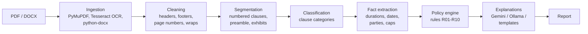

# ContractGuard

**AI-assisted contract risk and compliance review.** ContractGuard reads a contract (text PDF,
scanned PDF or Word file), splits it into clauses, works out what each clause is about, pulls out
the facts that matter (notice periods, liability caps, renewal terms, payment days, governing
law), checks them against your organization's policy, and explains every flag in plain English
with the exact clause and page it came from.

> ContractGuard produces AI-assisted review flags to support contract reviewers. It is not legal
> advice and does not determine legal validity.

**Status:** every stage is built and tested end to end: reading files and OCR, clause splitting,
classification, fact extraction, the policy engine, AI explanations, the FastAPI backend and the
Streamlit UI (308 automated tests). The classifier is trained on LEDGAR + CUAD and the
end-to-end evaluation has been run (see [Measured results](#measured-results)). What is still
open is the human labelling of the gold set, the human rating of the LLM explanations, and the
documentation PDF. See [Project status](#project-status) for exactly what exists today.

---

## Contents

- [Why ContractGuard](#why-contractguard)
- [How it works](#how-it-works)
- [Project status](#project-status)
- [Measured results](#measured-results)
- [Getting started](#getting-started)
- [Train the models](#train-the-models)
- [Run the app](#run-the-app)
- [Try it](#try-it)
- [Configuration](#configuration)
- [Repository layout](#repository-layout)
- [Development](#development)
- [The gold test set](#the-gold-test-set)
- [Known limitations](#known-limitations)
- [Privacy](#privacy)
- [Further reading](#further-reading)

---

## Why ContractGuard

Reviewing vendor, SaaS and NDA contracts against an internal checklist is slow and repetitive:
find the termination clause, check the notice period, check whether liability is capped, check
the governing law, and repeat for every contract. ContractGuard does that first pass and hands
the reviewer a short list of findings, each with:

- the **rule** that was checked and its **severity**,
- what the policy **expected** and what the contract **says**,
- the **evidence**: the exact sentence, clause number and page,
- a plain-English **explanation** and a suggested next step.

Design principles:

- **Deterministic decisions.** A rule engine decides every finding's status, and the policy file
  decides its severity. The language model only writes the explanation afterwards, and its quotes
  are checked against the real clause text.
- **Everything configurable.** Thresholds, regex patterns, label maps and rules live in
  `config/*.yaml` and `policies/*.json`, never in Python code.
- **Explainable by construction.** No finding without a clause reference (except "clause missing").
- **Runs locally on a CPU.** No GPU and no vector database. Uploads stay on your machine.

## How it works



| Stage | What it does |
|---|---|
| **Ingestion** | Detects the file type from its extension *and* magic bytes. Reads PDF text page by page; pages with no text layer go to Tesseract OCR, and low-confidence pages are flagged. Rebuilds Word auto-numbering ("7.2", "(a)") that python-docx does not expose. |
| **Cleaning** | Removes running headers, footers and page numbers, rejoins hyphenated and wrapped lines, normalizes quotes and dashes. Keeps an offset map so every clause can point back to its page. |
| **Segmentation** | Splits on `ARTICLE`/`SECTION`/numbered headings and Word heading styles, keeps lettered sub-items inside their parent, recognizes the preamble, signature block and schedules, merges tiny fragments and splits very long clauses at sentence boundaries. Tolerates OCR misreads such as "ARTICLE Ill". |
| **Classification** | Assigns one or more of 10 categories (termination, liability, payment, renewal, governing law, SLA, ...) with a TF-IDF + linear model trained on public datasets (LEDGAR, CUAD) and per-category tuned thresholds. SLA clauses are found by keyword rules; anything still unlabelled goes to a MiniLM embedding fallback marked low confidence. |
| **Fact extraction** | Normalizes durations ("thirty (30) business days" → 42 days, "Net 30" → 30), finds parties and decides which one is your organization, reads effective and expiry dates, and extracts the seven facts the policy needs. Handles negation ("shall **not** be liable for any and all damages") and "including but not limited to". |
| **Policy engine** | Evaluates each rule to COMPLIANT, NON_COMPLIANT, MISSING, NEEDS_REVIEW or NOT_APPLICABLE, deterministically. When no clause has the category of a rule, a semantic search over the clauses turns a would-be MISSING into NEEDS_REVIEW if a clause looks like it covers the rule. |
| **Explanations** | One short explanation per flagged finding from Gemini or a local Ollama model. The quoted evidence must be an exact substring of the clause, and every number must appear in the input; otherwise the answer is retried once and then replaced by a template. Calls are rate limited, retried with backoff and cached in SQLite. |
| **API and UI** | FastAPI backend (background jobs, one at a time, SQLite) and a Streamlit front end: Upload & Analyze, Report Dashboard, Clause Explorer, Policy Editor. |

More detail: [docs/ARCHITECTURE.md](docs/ARCHITECTURE.md).

## Project status

The build follows the phase plan in the design document (HLD §14). Each phase has an acceptance
check, and results are generated by scripts in `evaluation/`, not typed by hand.

| Phase | Deliverable | Status |
|---|---|---|
| 0 | Skeleton, config loader, data models, CLI, tooling | ✅ Done |
| 1 | Gold test set (8 contracts × 3 formats), labelling guideline | ✅ Built. Human labelling by two reviewers still open |
| 2 | Ingestion (PDF, OCR, DOCX) and cleaning | ✅ Done |
| 3 | Clause segmentation | ✅ Done (2 public CUAD contracts still to add) |
| 4 | Clause classifier, thresholds, prototypes | ✅ Trained on LEDGAR + CUAD (linear SVC, test macro-F1 0.854). Model files are not committed; rebuild with `training/` |
| 5 | Fact extraction, contract metadata, contract type | ✅ Done |
| 6 | Policy engine, default policy, schema validation, versioned edits | ✅ Done |
| 7 | LLM explanations (Gemini, Ollama, mock), cache, grounding, templates | ✅ Done (live run with Ollama + Qwen2.5-3B; no live Gemini run yet) |
| 8 | FastAPI backend, SQLite, jobs | ✅ Done |
| 9 | Streamlit UI (4 pages) | ✅ Done |
| 10 | Full evaluation, demo script, documentation PDF | 🟡 Evaluation run (numbers below); human labelling, human E7 rating and the documentation PDF still to do |

## Measured results

All numbers come from `evaluation/results/*.md`, produced by the scripts named below on the 8
gold contracts in three formats (24 files).

| Check | Script | DOCX | Text PDF | Scanned PDF | Target |
|---|---|---|---|---|---|
| Files loaded | `eval_ingestion.py` | 8/8 | 8/8 | 8/8 | all |
| OCR character error rate | `eval_ingestion.py` | n/a | n/a | 1.10% mean, 1.76% max | < 5% |
| Clause boundary F1 | `eval_segmentation.py` | 1.000 | 0.986 | 0.986 | ≥ 0.85 |
| Fact accuracy (7 facts) | `eval_facts.py` | 100% | 100% | 100% | ≥ 85% |
| Metadata accuracy (parties, dates, law, type) | `eval_facts.py` | 100% | 100% | 100% | n/a |
| Policy violations found (recall / precision, gold categories, LLM off) | `eval_policy.py` | 100% / 100% | 100% / 100% | 100% / 100% | ≥ 85% / ≥ 80% |
| Clause classification macro-F1 on the LEDGAR + CUAD test split (E1, linear SVC) | `training/evaluate.py` | 0.854 (one test split, not per format) | | | ≥ 0.75 |
| Policy violations found end to end (E5 recall / precision, trained classifier, LLM off) | `run_e2e_eval.py` | 88.9% / 100% | 88.9% / 100% | 88.9% / 100% | ≥ 85% / ≥ 80% |
| Rule status, text PDF vs scanned PDF (E3) | `run_e2e_eval.py` | | 100% | | ≥ 90% |
| Semantic retrieval Precision@3 / Recall@3 / MRR (E6) | `run_e2e_eval.py` | 35.2% / 96.5% / 0.909 | same | same | P@3 ≥ 70% |
| Seconds per contract, NLP only (E8 mean / max) | `run_e2e_eval.py` | 0.26 / 0.70 | 0.20 / 0.60 | 7.19 / 10.6 | < 30 s |
| LLM explanations that passed the grounding checks (E7, Qwen2.5-3B on Ollama, CPU) | `make_rating_sheet.py` | | 18/20 (90%) | | n/a |

**Read these numbers with care.** They are optimistic, for three reasons:

1. The gold contracts were written for this project with clean, regular numbering. The scans
   are simulated (rendered, skewed, blurred and noised), not printed and scanned.
2. The gold labels are still a **draft** until two people label the contracts independently.
3. Fact accuracy and the isolated policy check (`eval_policy.py`) use the gold clause
   categories. The end-to-end rows (`run_e2e_eval.py`, trained classifier) are the ones to quote.

**Reading the end-to-end results (2026-10-26).**

- E5: the 5 status errors per format are all on the safe side or harmless. GC03 R05/R06/R10
  and GC06 R05 come out NEEDS_REVIEW instead of MISSING / NOT_APPLICABLE, because the
  semantic search found a clause above `tau_missing` (0.55); GC08 R05 is NOT_APPLICABLE
  because the classifier missed the renewal sentence in clause 3. `tau_missing` was not tuned
  on the gold set, on purpose.
- E6 misses its target. Most rules have one relevant clause, so Precision@3 cannot go much
  above 33%; Recall@3 (96.5%) and MRR (0.909) show the right clause is nearly always ranked
  first. The target needs redefining (for example Precision@1) rather than tuning.
- E7: the human rating is still to do (`evaluation/llm_rating_sheet.csv`). An AI pre-rating
  of the 18 LLM explanations (`evaluation/llm_rating_ai.csv`, not a human rating) gives mean
  faithfulness 4.0, relevance 4.5, clarity 4.1, actionability 3.4 (1-5) and no invented
  numbers; two explanations misread the clause (GC01 R04, GC05 R01). With the LLM on, a
  contract took about 100 s on 4 CPU cores (about 30 s per explanation).
- The gold labels are still a draft. An AI second labelling from the PDFs agrees on 100% of
  rule statuses, 97% of clause categories and 54/56 facts
  (`evaluation/results/agreement_labeller_ai.md`), but it is not an independent human check.

Real-world accuracy, especially on contracts unlike the gold set, will be lower. The reasoning
behind each number is recorded in [docs/DECISIONS.md](docs/DECISIONS.md) (D16, D21, D29).

## Getting started

### Requirements

- **Python 3.11 or later**
- **Tesseract OCR 5** for scanned PDFs
- **LibreOffice** only if you want to rebuild the gold set's PDFs

### Linux (Ubuntu / Debian)

```bash
sudo apt install tesseract-ocr          # add libreoffice to rebuild the gold set
git clone https://github.com/Sanjeev-07-psypher/ContractGuard.git
cd ContractGuard
python3.11 -m venv .venv
source .venv/bin/activate
pip install -e ".[dev,app,training]"
python -m spacy download en_core_web_sm  # optional: fallback for finding party names
pytest
```

### Windows (PowerShell)

1. Install Python 3.11+ from python.org and tick **Add python.exe to PATH**.
2. Install Tesseract with the UB-Mannheim installer
   (<https://github.com/UB-Mannheim/tesseract/wiki>).
3. Then:

```powershell
git clone https://github.com/Sanjeev-07-psypher/ContractGuard.git
cd ContractGuard
py -3.11 -m venv .venv
.venv\Scripts\activate
pip install -e ".[dev,app,training]"
python -m spacy download en_core_web_sm
$env:CG_OCR__TESSERACT_CMD = "C:\Program Files\Tesseract-OCR\tesseract.exe"
pytest
```

Set `CG_OCR__TESSERACT_CMD` permanently (or in `.env`) if Tesseract is not on your `PATH`.

### Optional extras

| Extra | Installs | Needed for |
|---|---|---|
| `dev` | pytest, ruff, mypy, httpx, reportlab | development, tests and the gold-set builder |
| `training` | Hugging Face `datasets` | downloading LEDGAR |
| `app` | FastAPI, Uvicorn, SQLModel, Streamlit, requests | the API and UI |

PyTorch comes in with `sentence-transformers`. On a CPU-only machine you can install the smaller
CPU wheel first: `pip install torch --index-url https://download.pytorch.org/whl/cpu`.
Local explanations with Ollama need no extra package: install Ollama, `ollama pull llama3.1:8b`,
and set `LLM_PROVIDER=ollama`, `LLM_MODEL=llama3.1:8b`.

## Train the models

The classifier is trained once and saved to `models/` (not committed). On a 4-core laptop the
TF-IDF models take minutes; MiniLM encoding takes longer.

```bash
# 1. Data: CUAD from GitHub, LEDGAR from Hugging Face
mkdir -p data/raw/cuad
curl -L -o data/raw/cuad/data.zip https://github.com/TheAtticusProject/cuad/raw/main/data.zip
unzip data/raw/cuad/data.zip -d data/raw/cuad
python training/inspect_labels.py        # prints and saves the real label names
python training/prepare_cuad.py          # paragraph examples, split by contract 80/10/10
python training/prepare_ledgar.py        # official LexGLUE splits

# 2. Train, compare 5 models, tune thresholds (writes models/ and evaluation/results/)
python training/train_classifier.py
python training/evaluate.py              # E1 on the test split + confusion matrix
python training/build_prototypes.py      # embedding fallback + tuned proto_threshold
```

Copy the printed `proto_threshold` into `config/settings.yaml`. Details and the design of the
label masks are in [training/README.md](training/README.md).

## Run the app

```bash
cp .env.example .env                     # add GEMINI_API_KEY and LLM_MODEL, or LLM_PROVIDER=none
uvicorn backend.main:app --port 8000     # terminal 1: API on http://localhost:8000/docs
streamlit run frontend/app.py            # terminal 2: UI on http://localhost:8501
```

Or from the command line, without the UI:

```bash
python -m contractguard.cli analyze evaluation/gold/gc01/contract_scanned.pdf --no-llm -o report.json
```

If the models are not trained yet the API still starts: `/api/v1/health` and the home page say
what is missing. A walkthrough for presenting the project is in [docs/DEMO.md](docs/DEMO.md).

## Try it

The stages already work from Python. This runs on one of the scanned gold contracts:

```python
from contractguard.ingestion.router import load_document
from contractguard.preprocessing.cleaner import clean_document
from contractguard.segmentation.segmenter import segment
from contractguard.extraction.document import extract_meta

doc = load_document("evaluation/gold/gc01/contract_scanned.pdf")  # OCR runs here
clauses = segment(clean_document(doc), doc)
for c in clauses[:4]:
    print(c.clause_id, c.section_path, c.heading, f"page {c.page_start}")

meta = extract_meta(clauses, our_org="ABC Technologies Pvt. Ltd.")
print(meta.contract_type, meta.effective_date, meta.expiry_date)
print([(p.alias, p.role) for p in meta.parties])
```

Output:

```text
c001 PREAMBLE None page 1
c002 1 Definitions page 1
c003 2 Scope of Services page 1
c004 3 Term and Renewal page 1
VENDOR_SERVICE 2026-04-01 2027-03-31
[('Company', 'OUR_ORG'), ('Vendor', 'COUNTERPARTY')]
```

The whole pipeline, including classification, facts, policy and explanations, is one call:

```python
from contractguard.pipeline import Options, run

report = run("evaluation/gold/gc01/contract.docx", Options(use_llm=False))
for f in report.findings:
    print(f.status, f.severity, f.rule_id, f.location, f.reason)
```

Other commands:

```bash
python -m contractguard.cli --help     # CLI (also installed as `contractguard`)
python -m contractguard.cli config     # effective settings (secrets hidden)
```

## Configuration

| File | Holds |
|---|---|
| `config/settings.yaml` | limits, OCR, segmentation, model paths, LLM, organization defaults, paths |
| `config/patterns.yaml` | every regex: cleaning, segmentation, dates, durations, parties, facts |
| `config/contract_types.yaml` | keywords for contract type detection |
| `config/label_map.yaml` | dataset labels → ContractGuard categories |
| `config/templates.yaml` | the wording of reasons, expected/found values and template explanations |
| `policies/default_vendor_v1.json` | the 10 default rules (R01–R10), validated by `policies/policy.schema.json` |
| `.env` | secrets and model choice (copy `.env.example`; never commit `.env`) |

Any setting can be overridden with an environment variable named `CG_<SECTION>__<KEY>`, for
example `CG_LLM__RPM=4` or `CG_ORG__DATE_ORDER=MDY`. The order of precedence is: environment,
then `.env`, then `settings.yaml`. The API key is read from `GEMINI_API_KEY` and is never printed.

The default organization is set in `settings.yaml` under `org.default_name`. It decides which
party in a contract is "us". Dates are read day-first (`DMY`) by default, for Indian contracts.

## Repository layout

```text
config/            settings, patterns, label map, contract types
policies/          policy files and their JSON Schema
contractguard/     core package (no web framework imports)
  ingestion/       file type detection, PDF, OCR, DOCX
  preprocessing/   character normalization, header/footer and wrap cleaning
  segmentation/    clause splitting
  classification/  clause classifier, training building blocks, contract type
  extraction/      sentences, durations, dates, parties, entities, facts, metadata
  embeddings/      MiniLM encoder and cosine top-k
  policy/          policy schema, loading, versioned saving, rule engine
  llm/             providers (Gemini, Ollama, mock), prompts, explainer
  report/          report assembly
  pipeline.py      orchestrator: file -> Report
  models.py        Pydantic models passed between stages
  config.py        settings loader
  cli.py           command line
backend/           FastAPI app, SQLite tables, background jobs
frontend/          Streamlit app (app.py, home.py, pages/)
training/          dataset preparation, model training and E1 evaluation
evaluation/        gold set, evaluation scripts, generated results
docs/              architecture, decisions log, testing strategy
tests/             unit and pipeline tests
```

## Development

Every change must pass the four gates:

```bash
pytest                  # 305 tests
ruff check .
ruff format --check .
mypy                    # type checks contractguard and backend
```

Evaluation scripts write Markdown and JSON to `evaluation/results/`:

```bash
python evaluation/eval_ingestion.py      # files load, OCR error rate
python evaluation/eval_segmentation.py   # clause boundary precision / recall / F1
python evaluation/eval_facts.py          # fact and metadata accuracy
python evaluation/eval_policy.py         # policy engine with gold categories (E5, isolated)
python evaluation/run_e2e_eval.py        # full pipeline: E3, E5, E6, E8 (needs trained models)
python evaluation/make_rating_sheet.py   # E7: LLM explanations to rate (needs an LLM)
```

Tests never call a real model: the classifier, embedder and LLM are replaced by fakes, and the UI
tests drive each Streamlit page against a real local backend.

Conventions:

- Stages exchange Pydantic models only, never raw dicts.
- New thresholds or patterns go in `config/`, not in code.
- Every choice that the design document does not fix is recorded in
  [docs/DECISIONS.md](docs/DECISIONS.md) with its reason.
- Results are reported as measured. Draft or optimistic numbers are labelled as such.

## The gold test set

`evaluation/gold/` holds 8 contracts written for testing: 3 vendor service agreements, 2 SaaS or
licence agreements, 2 NDAs and 1 equipment rental agreement. All have Indian parties, and they
contain planted issues such as a 7-day notice period, uncapped liability, auto-renewal, a missing
SLA, foreign governing law and short payment terms. Each comes as:

- `contract.docx`, the original,
- `contract_text.pdf`, exported with LibreOffice,
- `contract_scanned.pdf`, a simulated scan,
- `gold.json`, the expected clauses, categories, facts and rule results.

Each contract is written once as `contract.yaml`. Then `python evaluation/gold/build_gold.py`
regenerates all the files. The gold set is never used for training or tuning thresholds.

**Labelling.** The current labels are a draft. Two people must label each contract
independently, following [evaluation/gold/GUIDELINES.md](evaluation/gold/GUIDELINES.md) and
`labelling_sheet.csv`. Disagreements are then resolved and logged in `ADJUDICATION.md`.

## Known limitations

- The classifier is trained on US SEC contracts, so accuracy on Indian contracts will be
  lower. This is why the gold set is Indian.
- There is no public labelled data for SLAs, so SLA detection relies on rules and examples.
- Regex fact extraction misses unusual wording. Those cases become NEEDS_REVIEW by design.
- A liability cap defined by a formula ("fees paid in the last 12 months") is detected as
  present, but its amount is not calculated.
- OCR quality depends on scan quality. Pages with low OCR confidence are flagged in the report.
- Running headers in documents shorter than 3 pages are not removed (see D10 and D15).
- LLM explanations are advisory. They are checked for quote grounding, not for legal
  correctness.

## Privacy

- Uploaded contracts stay on the machine running ContractGuard.
- With AI explanations on, only the single clause behind each finding is sent to the LLM
  provider. Free API tiers may use submitted data, so use a paid tier or the local Ollama
  option for confidential contracts.
- Secrets live in `.env`, which is git-ignored.

## Further reading

- [docs/ARCHITECTURE.md](docs/ARCHITECTURE.md): layers, data flows, security and privacy boundaries
- [docs/DECISIONS.md](docs/DECISIONS.md): every design decision and the reason for it
- [docs/TESTING.md](docs/TESTING.md): testing strategy and phase acceptance checks
- [docs/DEMO.md](docs/DEMO.md): a ten-minute demo script
- [training/README.md](training/README.md): data preparation, label masks and model selection
- [evaluation/results/](evaluation/results/): generated evaluation reports
