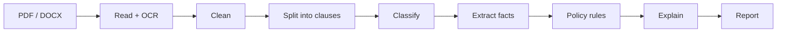

# ContractGuard

**AI-assisted contract risk and compliance review.** Upload a contract (text PDF, scanned PDF or
Word file). ContractGuard splits it into clauses, classifies them, extracts key facts (notice
periods, liability caps, renewal, payment terms, governing law), checks them against your
organisation's policy and explains every flag with the exact clause it is based on.

> ContractGuard produces AI-assisted review flags to support contract reviewers. It is not legal
> advice and does not determine legal validity.

## How it works



- **Read:** PyMuPDF and python-docx; Tesseract OCR for scanned pages.
- **Classify:** TF-IDF + linear SVM trained on LEDGAR and CUAD, with a MiniLM embedding fallback.
- **Policy:** 10 editable JSON rules; each finding is COMPLIANT, NON_COMPLIANT, MISSING,
  NEEDS_REVIEW or NOT_APPLICABLE.
- **Explain:** Gemini or a local Ollama model, checked against the clause text; templates otherwise.
- **App:** FastAPI backend and Streamlit UI (upload, report, clause explorer, policy editor).

## Results

Measured on 8 synthetic gold contracts in 3 formats (DOCX, text PDF, scanned PDF).

| Metric | Result | Target |
|---|---|---|
| Clause classification macro-F1 (test split) | 0.854 | ≥ 0.75 |
| Policy violations found end to end (recall / precision) | 88.9% / 100% | ≥ 85% / ≥ 80% |
| Clause boundary F1 | 0.986 to 1.000 | ≥ 0.85 |
| OCR character error rate | 1.10% | < 5% |
| Time per contract | 0.2 s text, about 7 s scanned | < 30 s |

The gold set is small and its labels are not yet human-confirmed, so these numbers are
optimistic. Full results and caveats: [evaluation/results/](evaluation/results/).

## Quick start

Needs Python 3.11+ and [Tesseract](https://github.com/tesseract-ocr/tesseract) for scanned PDFs.
The trained models are included in `models/`.

```bash
git clone https://github.com/Sanjeev-07-psypher/ContractGuard.git
cd ContractGuard
python -m venv .venv && source .venv/bin/activate   # Windows: .venv\Scripts\activate
pip install -e ".[app]"
cp .env.example .env                    # optional: GEMINI_API_KEY for AI explanations

uvicorn backend.main:app --port 8000    # terminal 1: API
streamlit run frontend/app.py           # terminal 2: UI at http://localhost:8501
```

For the exact versions the models were tested with, run `pip install -r deploy/requirements.txt`
first (the classifier needs scikit-learn 1.9.1).

Or with Docker: `docker build -t contractguard . && docker run -p 7860:7860 contractguard`, then
open http://localhost:7860.

## Development

```bash
pip install -e ".[dev,app,training]"
pytest && ruff check . && mypy          # 312 tests
```

## Documentation

- [Architecture](docs/ARCHITECTURE.md) and [module guides](docs/modules/README.md)
- [Design decisions](docs/DECISIONS.md)
- [Deployment](docs/DEPLOYMENT.md) (Streamlit Community Cloud and Docker)
- [Training the classifier](training/README.md)
- [All documentation as one PDF](docs/ContractGuard_Documentation.pdf)

## Privacy

Contracts stay on the machine running ContractGuard. With AI explanations on, only the clause
behind each finding is sent to the LLM; use the local Ollama option for confidential contracts.
Keep secrets in `.env`, which is git-ignored.
