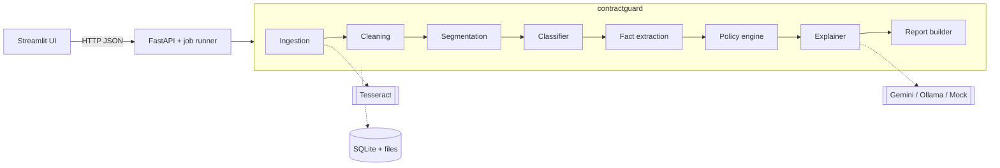

# Architecture

ContractGuard follows the HLD v1.0 without changes. This file is the working summary; the HLD is the
source of truth for details. Sections marked *planned* describe code that does not exist yet.

## Layers

| Layer | Owns | Must not |
|---|---|---|
| `frontend/` (Streamlit) *planned* | Upload form, progress polling, report dashboard, clause explorer, policy editor | Import `contractguard`; it talks to the API over HTTP only |
| `backend/` (FastAPI) *planned* | Upload validation, job queue (one job at a time), SQLite persistence, REST contracts | Contain NLP logic |
| `contractguard/` | Ingestion, cleaning, segmentation, classification, extraction, policy engine, explanations, report | Import FastAPI or Streamlit |
| `config/`, `policies/` | Every threshold, pattern, label map and rule | Live in Python code |
| `training/`, `evaluation/` | Offline model building and metrics | Run at request time |

Stages exchange Pydantic models only (`contractguard/models.py`):
`Document` → `list[Clause]` → `list[Fact]` → `list[Finding]` → `Report`.

The policy engine decides every status and the policy file decides every severity. The LLM only
writes explanations after that, and its quotes are checked against the clause text.

## Flow 1: analyse one contract

1. **Origin.** The reviewer uploads a PDF or DOCX with contract type, our organization's name,
   policy id and the AI toggle.
2. **Validation (API).** Extension and magic bytes must agree (`%PDF`, ZIP `PK`); ≤ 20 MB,
   ≤ 60 pages, ≤ 60,000 words; filename sanitized. Failure → HTTP 400 `{error_code, message}`.
3. **Storage.** File saved to `data/uploads/{contract_id}/`; `contracts` row with status `QUEUED`;
   the API returns 202 with the id.
4. **Processing** (background, one at a time): ingestion (PyMuPDF per page; Tesseract only for
   pages with < 50 characters and an image; python-docx with Word numbering rebuilt) → cleaning →
   segmentation → classification (+ embedding fallback) → fact extraction → policy evaluation.
5. **Explanation.** Only NON_COMPLIANT, MISSING and NEEDS_REVIEW findings, at most 15. One clause
   per LLM call. The quoted evidence must be an exact substring of the clause, else retry once, then
   a template.
6. **Storage.** Report JSON stored whole in `contracts.report_json`; clause and finding rows for
   filtering; LLM answers cached in `llm_cache`.
7. **Return.** The UI polls `/status` every 2 s, then reads `/report` once.

**Failure paths.** Encrypted PDF or missing Tesseract → clear error. OCR confidence < 70 → report
warning. LLM down or rate-limited → template explanations, report still produced. Stage exception →
`FAILED` with a readable message. Ambiguous or missing fact → `NEEDS_REVIEW`, never a guess.

## Flow 2: edit a policy

`PUT /policies/{id}` → JSON Schema validation (`policies/policy.schema.json`) → old file copied to
`policies/history/{id}@{version}.json` → patch version bumped. Every report records the policy
version it used.

## Flow 3: offline training

LEDGAR and CUAD → `config/label_map.yaml` → splits (LEDGAR official; CUAD grouped by contract,
80/10/10, seed 42) → five models compared → best by validation macro-F1 saved with per-class
thresholds and prototypes in `models/`. The gold set is never used for training or tuning.

## Security and privacy boundaries

- The only data leaving the machine is the single clause text sent to Gemini for a finding.
  Ollama keeps everything local. Demos use synthetic or public contracts only.
- Secrets live in `.env` (gitignored). `contractguard config` hides the API key.
- Uploads are untrusted: magic-byte check, size/page limits, sanitized filenames.
- No authentication in V1 (single user, localhost). CORS allows the Streamlit origin only.
- Full contract text is never logged at INFO. DELETE removes the file and all rows.
